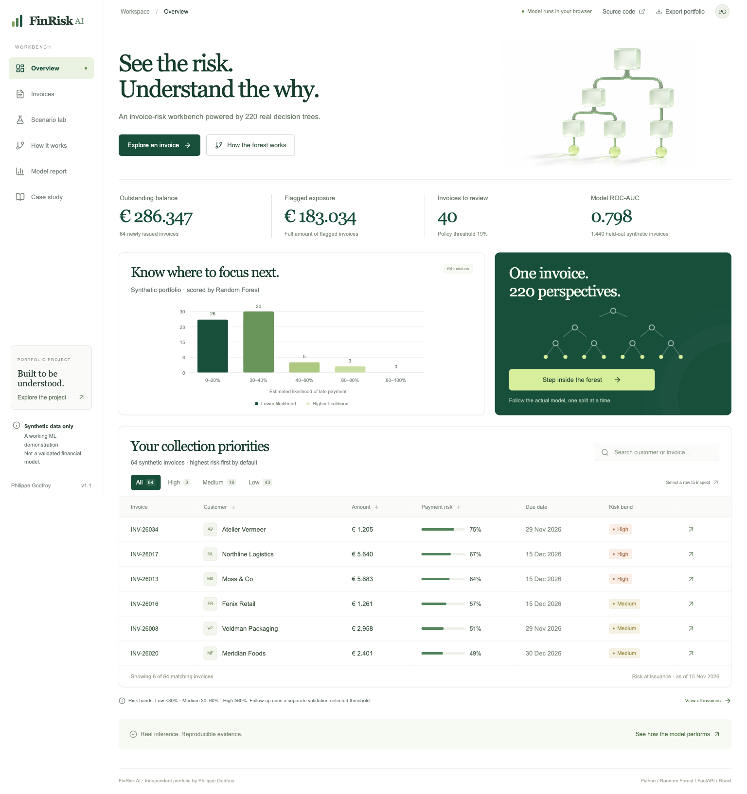
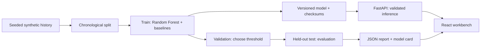

# FinRisk AI

**Payment risk, made clear.** An end-to-end ML portfolio by **Philippe Godfroy**: seeded invoice data → real Random Forest → honest evaluation → validated API → an interactive financial workbench.

**[Open the live GitHub Pages demo](https://phlppgdfry.github.io/finrisk-ai/)** · **[Explore a real tree](https://phlppgdfry.github.io/finrisk-ai/#learn)**



The project asks a practical question: **which newly issued invoices deserve human follow-up first?** Explore 64 synthetic invoices, inspect a prediction, test a customer profile, score a numeric CSV batch, and challenge the model against simpler baselines.

**Independent portfolio, built with AI assistance. Synthetic data only. No affiliation with BrightAnalytics, production-readiness claim, or validated financial performance.**

## Public demo: real ML in the browser

The GitHub Pages site runs all 220 exported trees directly in JavaScript. It uses the actual scikit-learn split thresholds and leaf probabilities, converts inputs with `Math.fround` to match sklearn float32 semantics, and averages the tree estimates. A parity test checks 824 Python reference cases including split-boundary values (maximum observed error about 2.22e-16). It is not a mock API or a rewritten scoring heuristic.

Open **How it works** to step through any of the 220 real trees, play its decision path, edit the invoice profile and compare the tree with the forest average. Explanation text is available in Dutch and English.

On the public site CSV scoring happens in browser memory. There is no remote Python server, account or invoice upload. The Python/FastAPI implementation remains available locally. Source ZIPs from GitHub contain source code; run `make restore` to recover the exact published model and data.

## Start on your Mac

Requires Python **3.13** and Node **22.12+** (Node 24 also tested). From the project directory:

```sh
make setup
make restore
make build
make check
make package
make run
```

Open **http://127.0.0.1:8011**. API documentation: **http://127.0.0.1:8011/docs**.

The supplied ZIP includes a model and built UI. After installing dependencies, `make run` is enough to explore it. `make train` regenerates your own model and report; restart the server afterwards. `make build` must run before starting FastAPI when no frontend build exists.

For UI development, run the API in one terminal and `npm --prefix frontend run dev` in another. Vite proxies `/api` to port 8011.

## What works

- **Overview:** actual portfolio totals, risk histogram, filterable collection priorities and CSV export.
- **Daily workflow:** 15-day ledger replay, ten-dossier capacity, customer cooldown, partial payments/credits, manual cold-start lane and three policy comparisons. [Contract and pilot](docs/OPERATIONS.md).
- **Invoices:** search, risk bands, sorting, accessible detail dialog and model sensitivity.
- **How it works:** inspect actual tree nodes, thresholds, alternative branches and leaf estimates; 220 clickable per-tree estimates; NL/EN explanations.
- **Scenario lab:** seven validated inputs, three presets, actual inference, first-run comparison and stale-result indicator.
- **CSV scoring:** exact feature schema, 1–250 rows, numeric validation, scores export and a descriptive shift diagnostic. No database writes.
- **Model report:** dummy/logistic baselines, confusion matrix, threshold exploration, permutation importance, reliability chart, test slices and artifact fingerprints.
- **Case study:** business question, architecture, choices, limits and next validation steps. Downloadable source and model card.

## Evidence from the included run

| Held-out metric | Random Forest | Logistic regression |
|---|---:|---:|
| ROC-AUC | 0.798 | 0.810 |
| Average precision / PR-AUC | 0.673 | 0.677 |
| Recall | 85.7% | 86.4% |
| Precision | 42.9% | 44.4% |
| Brier score ↓ | 0.158 | 0.154 |

**The simpler model wins here.** The forest is retained as an engineering showcase; a production choice must follow evidence. The low precision also means many unnecessary alerts. All metrics concern 1,440 held-out synthetic examples and cannot be transferred to real invoices.

Data: 7,200 synthetic invoices, seed 42. Chronological split: 4,320 train / 1,440 validation / 1,440 test. The forest threshold (19% in this run) minimises `FP + 5*FN` on validation data only. These are toy cost units. Risk bands (30% / 60%) are display categories, separate from the follow-up policy. Flagged exposure is not expected loss.

The authoritative values live in [artifacts/report.json](artifacts/report.json). [Standalone evaluation](docs/evaluation.html) is generated from that file.

## Architecture



```text
invoice_risk/   generation, training, evaluation and API
frontend/       React + TypeScript + Vite; no external model service
artifacts/      actual report, saved forest and local benchmark
scripts/        standalone report, source packaging, HTTP benchmark
tests/         API contracts, data leakage checks and evaluation invariants
 docs/          learning guide, model card, interview script, visuals and QA
.github/        quality-check workflow (runs after pushing to GitHub)
```

## API

```sh
curl -X POST http://127.0.0.1:8011/api/predict \
  -H 'Content-Type: application/json' \
  -d '{"amount":4500,"payment_terms":30,"customer_tenure":24,"prior_invoices":30,"prior_late_rate":0.35,"avg_days_late":12,"credit_utilisation":0.7}'
```

| Endpoint | Purpose |
|---|---|
| `GET /api/health` | Model readiness and version |
| `GET /api/portfolio` | 64 scored synthetic invoices |
| `POST /api/predict` | Single score, review flag, sensitivity and measured latency |
| `POST /api/batch` | 1–250 input records, scores and descriptive shift diagnostic |
| `GET /api/report` | Actual held-out evaluation and provenance |
| `GET /api/export` | Synthetic portfolio CSV |
| `GET /api/sample` | Numeric import template |
| `GET /api/model-card` | Download model card |
| `GET /api/source` | Download packaged source, model and UI |

CSV accepts seven exact columns, comma-separated, unquoted numeric cells. Download a template in the app. The UI limits files to 128 KB. Errors are shown; uploads do not alter the portfolio or create persistent history.

## Verify and package

```sh
make check       # Python lint, meaningful API/model checks, TypeScript
make benchmark   # requires running localhost API; warm loopback p50/p95
make package     # standalone report + verified distributable ZIP
# Optional first-time browser setup, then repeatable end-to-end checks:
npm --prefix frontend exec playwright install chromium
npm --prefix frontend run test:e2e
```

Python tests cover deterministic generation, disjoint chronological partitions, feature availability, schema validation, future-field rejection, batch limits, score consistency, threshold provenance, exports and artifact integrity. Browser QA covers filters, sorting, details, scenario comparisons, CSV success/error, model slider and responsive pages. See [verification](docs/VERIFICATION.md) for actual results and limits.

The CI and Pages definitions restore the checksum-verified release and check it on Python 3.13 / Node 22 and stores evaluation artifacts. The Pages workflow gates publication on Python checks, browser/Python parity and desktop/mobile browser tests.

Container option:

```sh
docker compose up --build
```

Compose maps **127.0.0.1:8011**, uses a non-root user, read-only filesystem and a temporary `/tmp`. Stop the local API first to free the port. The image restores the committed model release during build. See verification for whether Docker was available during this build.

## Understand it and present it

- [Nederlandstalige leergids](docs/LEERGIDS_NL.md)
- [Sollicitatie-demo en vragen](docs/INTERVIEW_NL.md)
- [Model card and limitations](docs/MODEL_CARD.md)
- [Data contract](docs/DATA_CONTRACT.md)
- [Design and browser verification](docs/VERIFICATION.md)

A job-worthy next step is to reproduce the run, change one component yourself, explain why logistic regression wins, and show how the error trade-off changes. Do not claim independent production ML experience just because this demo exists.

MIT licensed. No credentials or paid AI services required. The generated illustration is a visual metaphor, not customer or model evidence.

## Publish and reproduce the static site

```sh
make train
make pages
npm --prefix frontend exec playwright install chromium
npm --prefix frontend run test:pages
```

`make train` also exports browser data. `make pages` produces `frontend/dist-pages`. The Actions workflow restores the fixed model/dataset/report release before every deployment; documentation changes do not retrain it. Relative Vite base paths keep asset and download links valid below `/finrisk-ai/`. No secret API keys are needed.

Read [the next-step roadmap in Dutch](docs/ROADMAP_NL.md) for the most valuable improvements: real-data validation, operational baselines, calibrated scores and a measured pilot.

## Capacity-aware evaluation (November 2026 update)

Model report now compares top-5/10/20/50/100 prioritisation using Random Forest, logistic regression, highest amount and historical late rate. Validation and final test pools are separate. Outputs include precision@k, recall@k, lift, false alarms and indicative Wilson intervals. A random-selection expectation supplies context. This is offline ranking evidence on synthetic records; no collected revenue or causal benefit is implied.

How it works now compares actual tree structures and explains bootstrap sampling, feature subsampling, the configured 220-tree count and probability averaging.

Real-data status remains **not externally validated**. See [source review and admission contract](docs/REAL_DATA.md). A working local frozen-model evaluation command is supplied in `scripts/validate_real.py`. Authorised input data, feature provenance and label maturity must be provided before real-data validation can be completed.

## Operational release v1.2.0

Model, synthetic training dataset, report, browser export and daily replay are frozen together under `releases/v1.2.0` with SHA-256 integrity checks. [Daily workflow](https://phlppgdfry.github.io/finrisk-ai/#operations) shows multi-day prioritisation without attributing predetermined payments to reminders. The local real-data validator now requires explicit payment state and a dated ledger for reconstructing history. A separate customer-level pilot reporter checks allocation, equal windows and cash/time outcomes. **No real dataset or pilot result is claimed.** See [operational contract, pilot and release instructions](docs/OPERATIONS.md).
